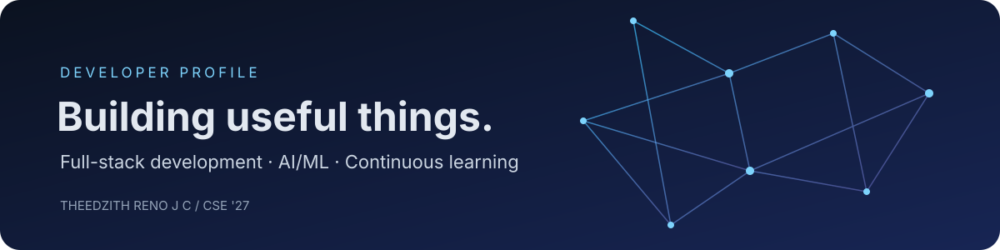

# Hey, I'm Theedzith Reno J C 👋

### Computer Science Engineering Student · Full-Stack Developer · AI/ML Builder

I build practical web applications and AI-powered projects with a focus on clean interfaces, useful features, and reliable engineering.

  
  
  

---

## About me

- 🎓 **B.E. Computer Science and Engineering** student at Jeppiaar Engineering College — graduating in 2027.
- 💻 Interested in **full-stack development, Python, and applied AI/ML**.
- 🧠 I enjoy turning ideas into usable products, from frontend experiences to backend APIs and ML integrations.
- 🏆 **1st place — MVP Sprint Hackathon (Feb 2026)** · **2nd prize — Ideathon’25 (Sep 2025)**.
- 🌱 Currently strengthening my foundations and building projects that demonstrate end-to-end engineering.

## Featured projects

<table>
  <tr>
    <td width="50%" valign="top">
      <h3>🌿 Agri Lens</h3>
      
An AI-assisted plant disease prediction experience designed to help users explore plant health through image-based detection.

      
<strong>Focus:</strong> Web application · AI integration · Plant disease detection

      

        <a href="https://github.com/Theedzith">View repositories →</a>
      

    </td>
    <td width="50%" valign="top">
      <h3>🧾 ResumeIQ</h3>
      
An AI-powered resume analyzer concept focused on helping candidates review and improve their resumes for job applications.

      
<strong>Focus:</strong> Full-stack development · Resume analysis · AI-assisted feedback

      

        <a href="https://github.com/Theedzith">View repositories →</a>
      

    </td>
  </tr>
  <tr>
    <td width="50%" valign="top">
      <h3>🧠 Mindora</h3>
      
A private AI journaling app with multi-turn journal conversations, summaries, takeaways, tags, mood tracking, and weekly insights.

      
<strong>Focus:</strong> Gemini · Firebase Authentication · Firestore

      

        <a href="https://github.com/Theedzith">View repositories →</a>
      

    </td>
    <td width="50%" valign="top">
      <h3>🛡️ Sentinel AI</h3>
      
A project exploring fake-account detection with a web interface and a machine-learning service.

      
<strong>Focus:</strong> MERN · Python · FastAPI · Scikit-learn

      

        <a href="https://github.com/Theedzith/Sentinel">View repository →</a>
      

    </td>
  </tr>
</table>

> **Tip:** Replace the “View repositories” links above with each project's exact repository URL once you confirm the repositories are public.

## Tech stack

**Languages**
 

**Frontend**
 

**Backend & data**
 

**AI/ML & tools**
 

## GitHub at a glance

  
  

  

## What I'm working toward

- Building stronger fundamentals in Python and software engineering.
- Shipping full-stack projects with thoughtful UX and secure backend practices.
- Learning to evaluate AI/ML systems with clear testing and meaningful metrics.

## Let's connect

I'm happy to connect about software development, AI projects, hackathons, and internship opportunities.

  <a href="https://www.linkedin.com/in/theedzith-jc-47346b291">LinkedIn</a>
  ·
  <a href="https://github.com/Theedzith">GitHub</a>

  Thanks for stopping by. Feel free to explore my repositories and share feedback.

